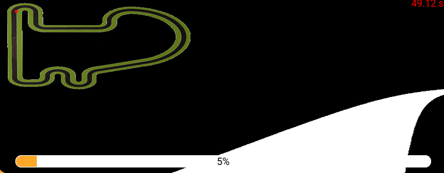
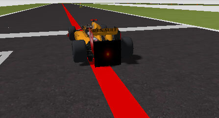
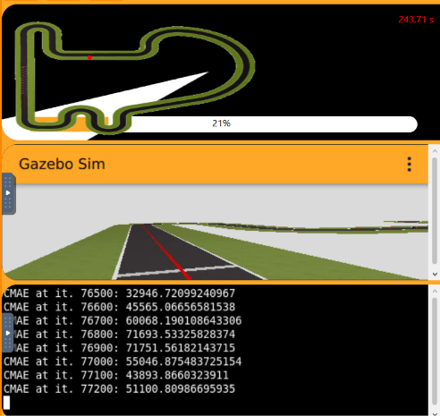
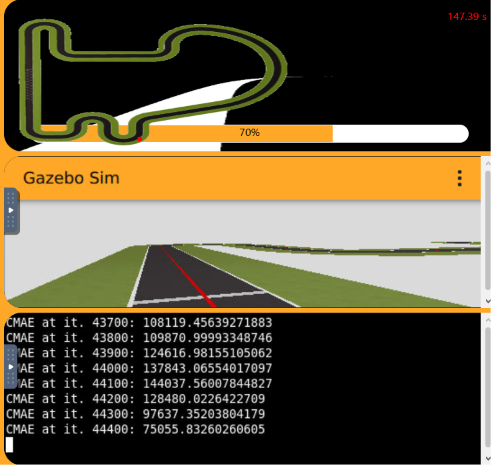
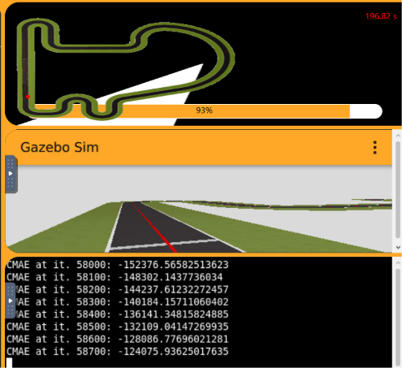
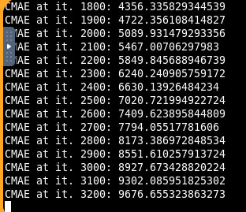

# Line Following Exercise

A small set of Python controllers for the [JdeRobot Robotics Academy Follow Line exercise](https://jderobot.github.io/RoboticsAcademy/exercises/AutonomousCars/follow_line/). The simulated car uses its camera image to detect the colored track and adjusts its angular velocity to stay on it.

## How it works

Each controller repeatedly obtains a camera frame with `HAL.getImage()` and:

1. Converts the BGR frame to HSV and thresholds it with `cv2.inRange()` to produce a binary mask of the track color (HSV range `(0, 125, 125)`–`(30, 255, 255)`).
2. Finds contours in the mask and computes the centroid of the first contour using image moments.
3. Computes a horizontal tracking error from the centroid and commands forward speed with `HAL.setV()` and steering speed with `HAL.setW()`.
4. Displays the threshold mask using `WebGUI.showImage()` so the detected track can be inspected while the controller runs.

The controllers differ in how they turn:

- **`P.py` — proportional:** steering is `Kp * error`. The current settings are `V = 4` and `Kp = 0.005`.
- **`PD.py` — proportional-derivative:** adds a term based on the change in error between frames. The current settings are `V = 4`, `Kp = 0.0055`, and `Kd = 0.0035`.
- **`PID.py` — proportional-integral-derivative:** includes proportional, derivative, and accumulated-error terms. The current settings are `V = 5`, `Kp = 0.01`, `Kd = 0`, and `Ki = 0`; therefore, as checked in, it behaves as a proportional controller. It also prints a cumulative moving-average error (CMAE) every 100 valid updates.

In all three scripts, the error is calculated as `len(img) / 2 - cX`. In NumPy images `len(img)` is the image height, while `cX` is a horizontal coordinate; for a general camera resolution, the horizontal center should instead be based on `img.shape[1] / 2`. The scripts also use the first contour returned by OpenCV rather than selecting the largest contour, so noise or multiple detected regions can affect tracking.

`PD.py` and `PID.py` stop their loop when no contour is found. `P.py` indexes the first contour without checking whether any were found, so it may fail if the track leaves the camera view. `Frequency` is imported by the scripts but is not used.

## Running

These scripts depend on the Robotics Academy runtime modules `HAL` and `WebGUI`, as well as OpenCV (`cv2`). They are intended to run from the Follow Line exercise environment, where the simulator provides the robot HAL and GUI; they are not standalone scripts for a regular Python interpreter.

1. Start the Follow Line exercise using the setup and launch instructions on the [Robotics Academy exercise page](https://jderobot.github.io/RoboticsAcademy/exercises/AutonomousCars/follow_line/).
2. Load or select one of `P.py`, `PD.py`, or `PID.py` as the exercise controller and start the simulation from the exercise interface.
3. Inspect the displayed mask and the simulator view. To try different behavior, adjust the controller constants near the top of the selected file and run the same track again.

## Execution examples

The `images/` directory contains example screenshots from the exercise and controller runs:

| Image | Example |
| --- | --- |
|  | Follow Line exercise overview |
|  | Simulated car |
|  | Run example 1 |
|  | Run example 2 |
|  | Run example 3 |
|  | Cumulative moving-average error visualization |

## Performance measurements

`log.csv` records tested controller parameters and lap times. `DNF` means the run did not finish. Of the recorded successful runs, the shortest lap was **179.03 s** with `V = 6`, `Kp = 0.005`, `Kd = 0.000025`, and `Ki = 0.0000001`. The results show that increasing speed alone did not guarantee completion; tuning the steering gains together with speed mattered in these trials.

| V | Kp | Kd | Ki | Lap time (s) |
| ---: | ---: | ---: | ---: | ---: |
| 10 | 0.01 | 0 | 0 | DNF |
| 5 | 0.01 | 0 | 0 | DNF |
| 2 | 0.005 | 0 | 0 | 472.48 |
| 4 | 0.005 | 0 | 0 | 300.56 |
| 8 | 0.005 | 0.005 | 0 | DNF |
| 6 | 0.005 | 0.0025 | 0 | 211.21 |
| 4.5 | 0.0035 | 0.001 | 0 | 288.81 |
| 6 | 0.005 | 0.0025 | 0.005 | DNF |
| 5 | 0.005 | 0.001 | 0.0005 | DNF |
| 2.5 | 0.005 | 0.0025 | 0.000005 | 465.36 |
| 4 | 0.005 | 0.0025 | 0.000005 | 257.11 |
| 6 | 0.005 | 0.0005 | 0.0000005 | DNF |
| 6 | 0.005 | 0.000025 | 0.0000001 | **179.03** |
| 6 | 0.00055 | 0.000025 | 0.0000001 | 203.46 |

These are recorded experiment results, not a guarantee of repeatable performance. The best logged parameter set does not match the constants currently checked into `P.py`, `PD.py`, or `PID.py`; use the values in `log.csv` when reproducing that particular trial.

## Repository contents

- `P.py` — proportional controller.
- `PD.py` — proportional-derivative controller.
- `PID.py` — proportional-integral-derivative controller with CMAE reporting.
- `log.csv` — parameter combinations and measured lap outcomes.
- `images/` — exercise and run screenshots.
